# Complete DevOps Project — End-to-End CI/CD, Kubernetes & Monitoring

A hands-on DevOps portfolio project demonstrating automated testing, CI/CD, containerization, Kubernetes orchestration, Infrastructure as Code, deployment automation, and monitoring.

## Architecture

```text
Java Application
       |
       v
Maven + JUnit Tests
       |
       v
GitHub Repository
       |
       +---- GitHub Actions
       +---- Jenkins
       +---- SonarQube
       |
       v
Docker Image
       |
       v
Kubernetes (Minikube)
       |
       +---- Deployment & Service
       +---- Health Checks
       +---- Self-Healing
       +---- Horizontal Pod Autoscaling
       |
       +---- Terraform
       +---- Ansible
       |
       v
Prometheus
       |
       v
Grafana Dashboard
```

## Technology Stack

| Category | Technologies |
|---|---|
| Programming | Java 21 |
| Build & Testing | Maven, JUnit 5 |
| Version Control | Git, GitHub |
| CI/CD | GitHub Actions, Jenkins |
| Containerization | Docker |
| Code Quality | SonarQube |
| Orchestration | Kubernetes, Minikube |
| Infrastructure as Code | Terraform |
| Automation | Ansible |
| Monitoring | Prometheus, Grafana |
| Environment | Windows 10, Ubuntu WSL |

## Project Features

- Built a Java HTTP application with health and metrics endpoints.
- Implemented Maven builds and JUnit unit tests.
- Containerized the application using Docker.
- Configured GitHub Actions for CI automation.
- Used Jenkins for local CI/CD experimentation.
- Performed static code analysis using SonarQube.
- Deployed the application to Kubernetes using Minikube.
- Configured two application replicas.
- Implemented readiness and liveness probes.
- Demonstrated Kubernetes self-healing.
- Configured Horizontal Pod Autoscaling from 2 to 4 replicas.
- Provisioned Kubernetes resources using Terraform.
- Automated deployment and verification using Ansible.
- Configured Prometheus metrics collection.
- Created a Grafana monitoring dashboard.
- Configured a 2 GiB PersistentVolumeClaim for Grafana.

## Application Endpoints

The application listens on port `8082`.

| Endpoint | Description |
|---|---|
| `/` | Application response |
| `/health` | Health status |
| `/metrics` | Prometheus metrics |

## Maven Build and Tests

```bash
mvn clean test
mvn clean package
```

## Docker

Build the image:

```bash
docker build -t complete-devops-app:2.0 .
```

Run the container:

```bash
docker run -d --name complete-devops-web -p 8083:8082 complete-devops-app:2.0
```

Test the application:

```bash
curl http://localhost:8083/health
```

## Kubernetes

Start Minikube and load the Docker image:

```bash
minikube start --driver=docker
minikube image load complete-devops-app:2.0
```

Deploy Kubernetes resources:

```bash
kubectl apply -f kubernetes/deployment.yaml
kubectl apply -f kubernetes/service.yaml
kubectl apply -f kubernetes/hpa.yaml
```

Verify:

```bash
kubectl get pods
kubectl get services
kubectl get hpa
```

## Terraform

Terraform manages a separate Kubernetes deployment in the `devops-terraform` namespace.

```bash
cd terraform
terraform init
terraform plan
terraform apply
```

To destroy Terraform-managed resources:

```bash
terraform destroy
```

## Ansible

Environment verification:

```bash
ansible-playbook -i ansible/inventory.ini ansible/check-environment.yml
```

Kubernetes verification:

```bash
ansible-playbook -i ansible/inventory.ini ansible/check-kubernetes.yml
```

Kubernetes deployment:

```bash
ansible-playbook -i ansible/inventory.ini ansible/deploy-kubernetes.yml
```

## Prometheus Monitoring

Deploy Prometheus:

```bash
kubectl create namespace monitoring --dry-run=client -o yaml | kubectl apply -f -
kubectl apply -f monitoring/prometheus-config.yaml
kubectl apply -f monitoring/prometheus-deployment.yaml
```

Access Prometheus:

```bash
kubectl port-forward -n monitoring service/prometheus 9090:9090
```

Open http://localhost:9090

Example PromQL query:

```promql
app_requests_total
```

## Grafana Monitoring

Deploy Grafana with persistent storage:

```bash
kubectl apply -f monitoring/grafana-pvc.yaml
kubectl apply -f monitoring/grafana-deployment.yaml
```

Access Grafana:

```bash
kubectl port-forward -n monitoring service/grafana 3001:3000
```

Open http://localhost:3001

Prometheus data source URL:

```text
http://prometheus.monitoring.svc.cluster.local:9090
```

Dashboard backup:

`monitoring/grafana-dashboard.json`

Grafana uses a 2 GiB PersistentVolumeClaim for persistent configuration storage.

## Project Screenshots

### Development and CI/CD

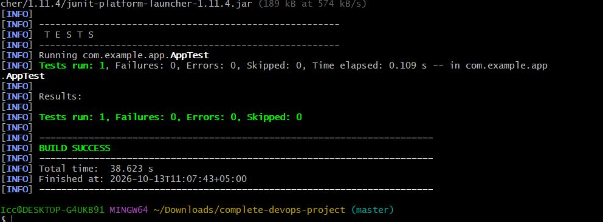

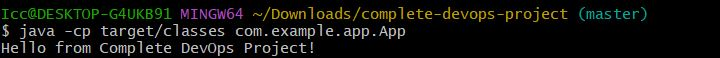

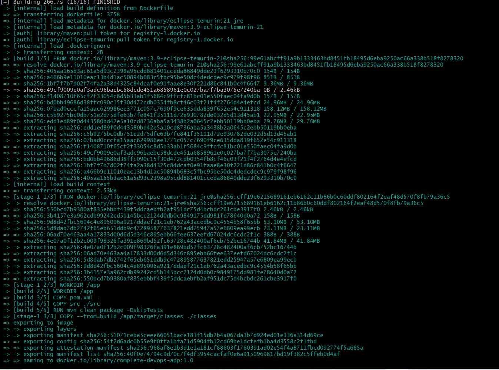

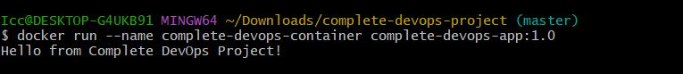

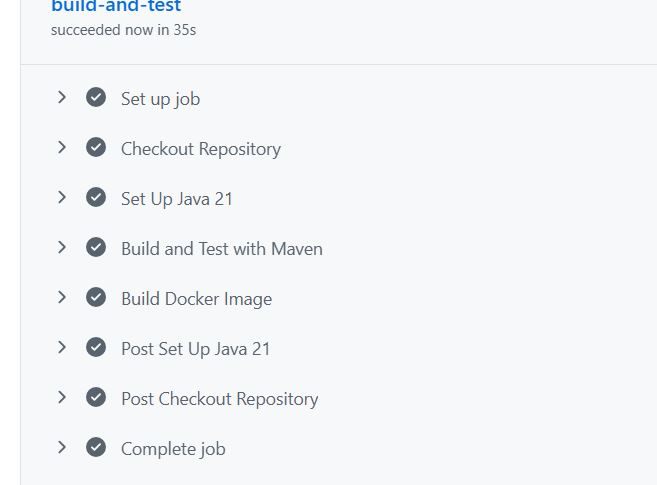

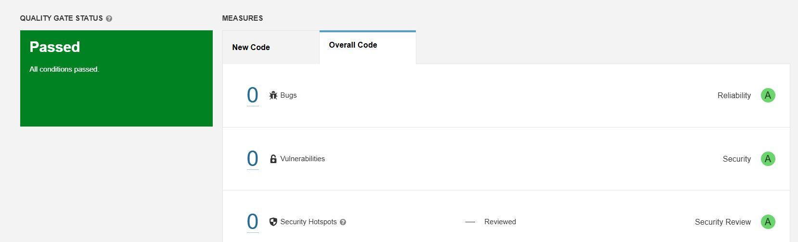

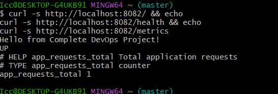

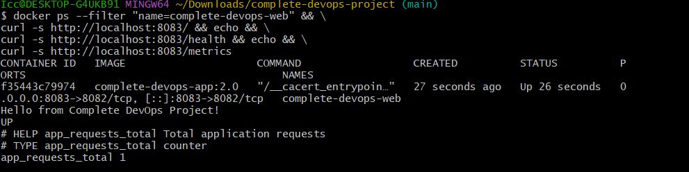

### Kubernetes

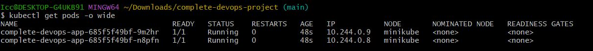

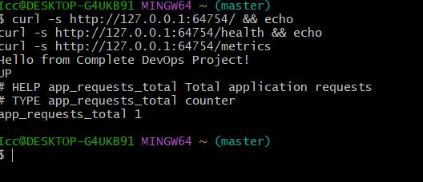

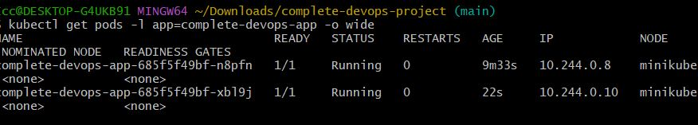

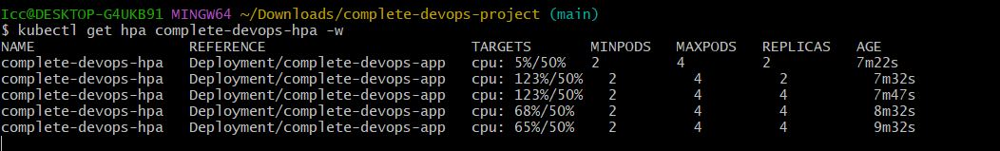

### Terraform

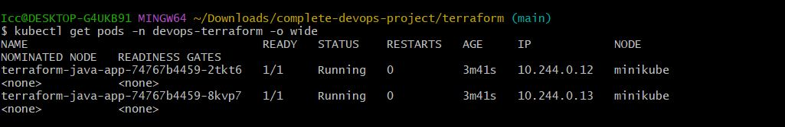

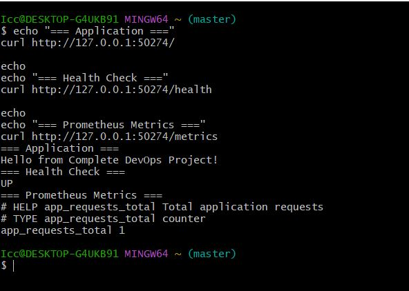

### Ansible

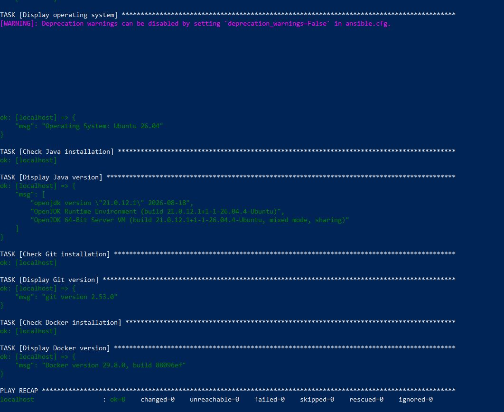

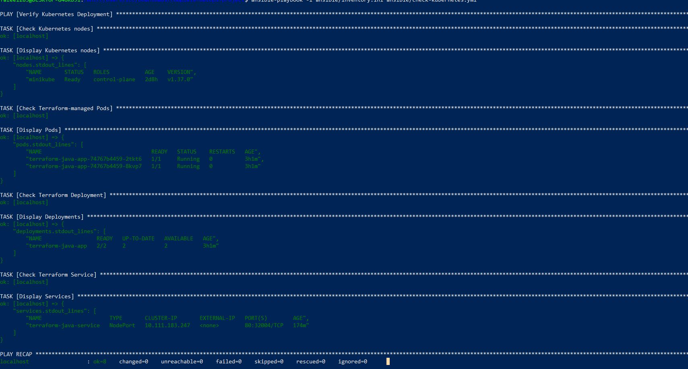

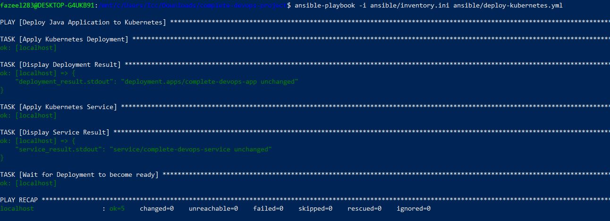

### Monitoring


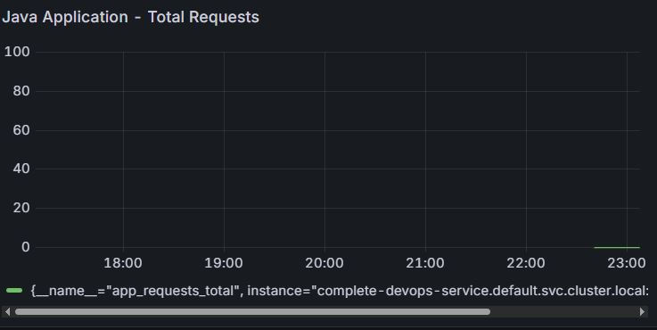

## Key Learning Outcomes

- CI/CD pipeline development
- Automated application testing
- Docker containerization
- Kubernetes deployment and orchestration
- Kubernetes health checks and autoscaling
- Infrastructure as Code with Terraform
- Deployment automation with Ansible
- Monitoring with Prometheus and Grafana
- Kubernetes persistent storage

## Environment

This project runs locally using Windows 10, Ubuntu WSL, Docker Desktop, and Minikube.

No AWS infrastructure is required.

## Author

**Muhammad Fazeel**

GitHub: https://github.com/fazeel28329

LinkedIn: https://www.linkedin.com/in/muhammad-fazeel-617526426/
